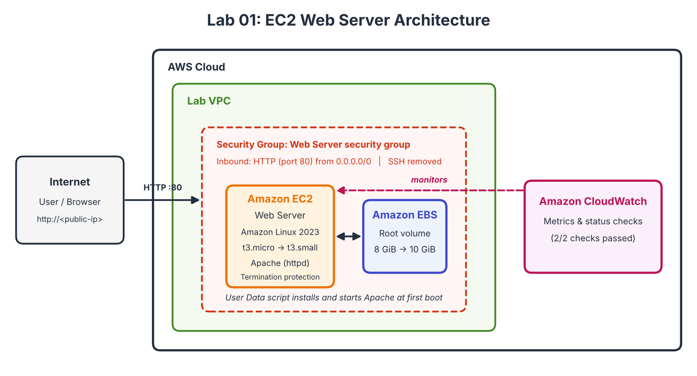
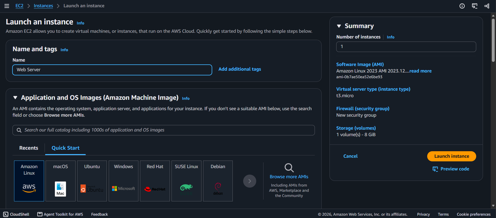
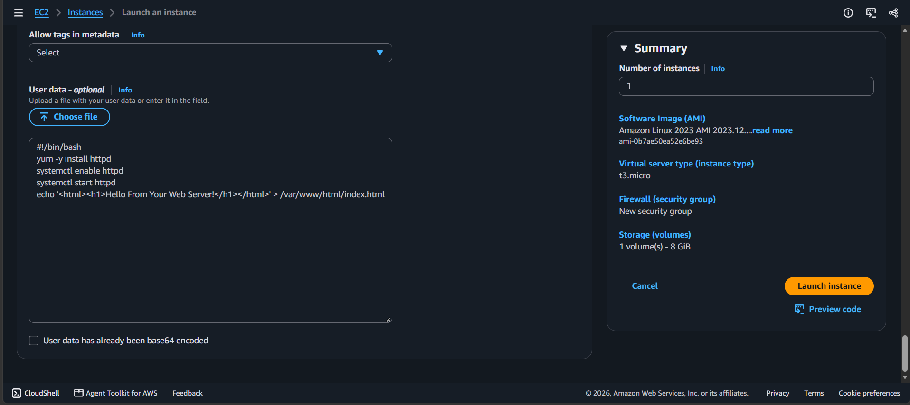
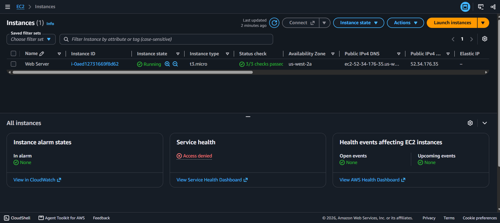
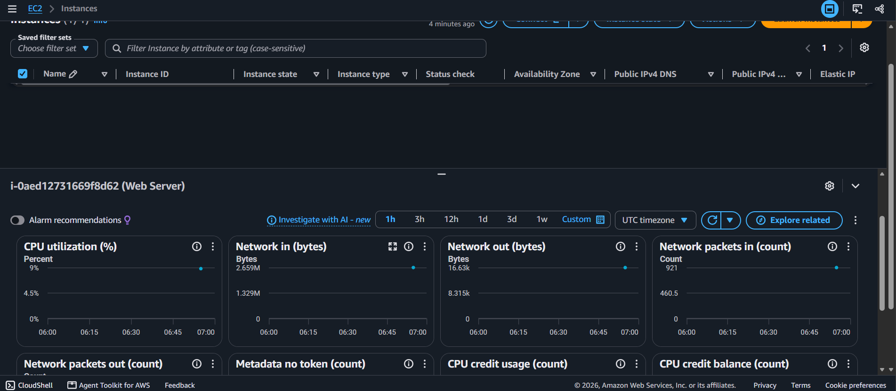
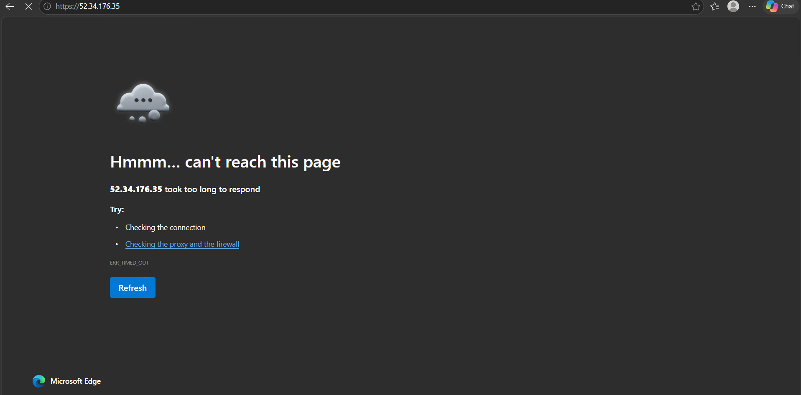
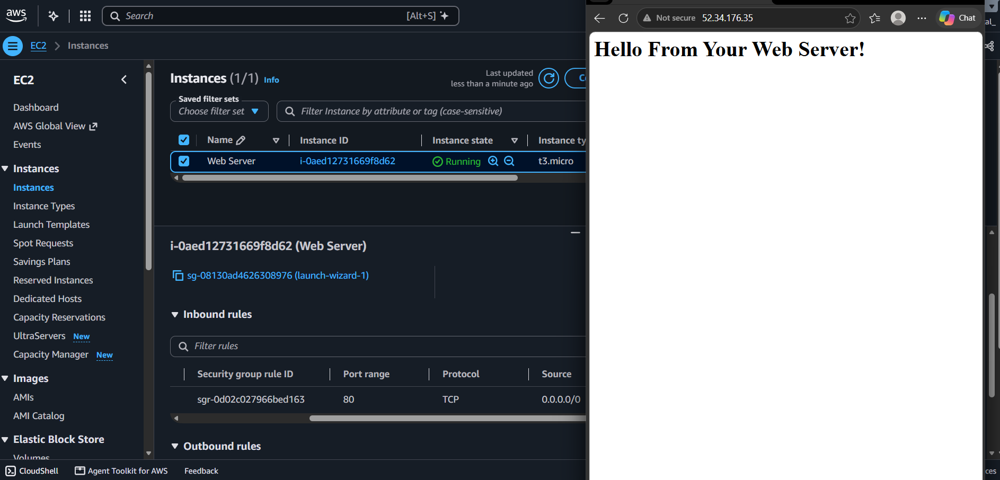
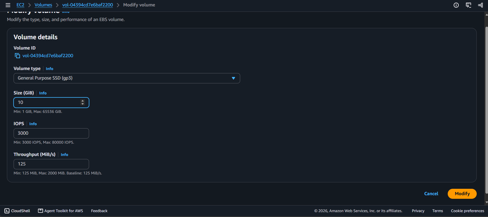
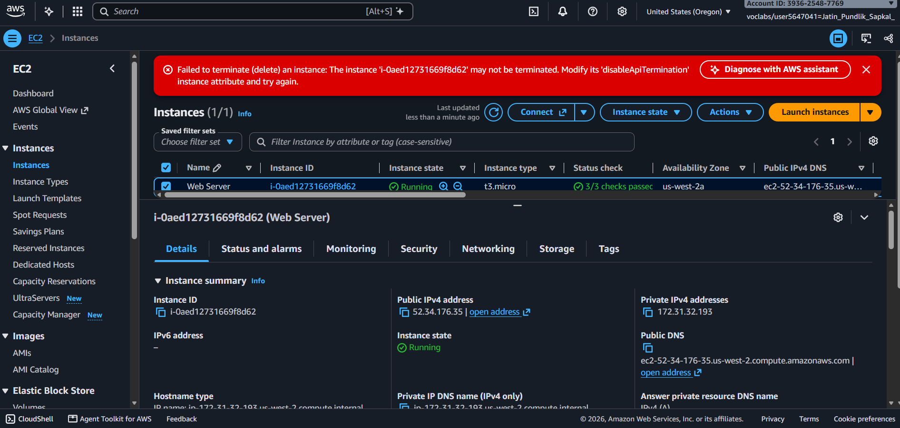

# Lab 01: Launching and Managing an Amazon EC2 Web Server

Hands-on lab completed as part of the AWS re/Start program. I launched an EC2 instance with a web server, monitored it, fixed a firewall problem, resized it, and tested termination protection.

## Objective

Launch a web server on Amazon EC2 and practice the full instance lifecycle: configure, secure, monitor, scale and terminate.

## Services Used

| Service | Purpose |
|---|---|
| Amazon EC2 | Virtual server running the web server |
| Amazon EBS | Root volume (resized from 8 GiB to 10 GiB) |
| Security Groups | Virtual firewall controlling HTTP access |
| Amazon CloudWatch | Instance monitoring and metrics |
| VPC | Network the instance was launched into |

## Architecture

> Add your own simple diagram here (draw.io works well): Internet -> Security Group (port 80) -> EC2 instance (Apache) -> EBS volume, all inside a VPC.



## What I Did

### 1. Launched the instance
- Named the instance `Web Server` and used the **Amazon Linux 2023** AMI with a **t3.micro** instance type.
- Launched it into the lab VPC with a new security group and removed the default SSH rule, since I did not need to log in. This reduces the attack surface.
- Enabled **termination protection** to prevent accidental deletion.
- Used a **User Data** script to install and start Apache automatically at boot:

```bash
#!/bin/bash
yum -y install httpd
systemctl enable httpd
systemctl start httpd
echo '<html><h1>Hello From Your Web Server!</h1></html>' > /var/www/html/index.html
```




### 2. Monitored the instance
- Confirmed the instance state was **Running** with **2/2 status checks passed**.
- Reviewed CloudWatch metrics in the Monitoring tab (basic monitoring is 5-minute intervals by default).
- Used **Get Instance Screenshot** to see the instance console without logging in, which is useful for troubleshooting.




### 3. Fixed the security group
- Opened the instance's public IP in the browser and the page **did not load**.
- **Cause:** the security group had no inbound rule allowing HTTP on port 80.
- **Fix:** added an inbound rule for **HTTP (port 80)** from anywhere (IPv4). After refreshing, the page showed "Hello From Your Web Server!".




### 4. Resized the instance
- Stopped the instance (required before changing its type).
- Changed the instance type from **t3.micro** to **t3.small** (more memory).
- Increased the EBS root volume from **8 GiB to 10 GiB**.
- Started the instance again.



### 5. Tested termination protection
- Tried to terminate the instance and it **failed** with an error because termination protection was on.
- Disabled termination protection, then terminated the instance successfully.



## Problems and Fixes

| Problem | Cause | Fix |
|---|---|---|
| Web page not loading | Security group had no rule for port 80 | Added an inbound HTTP rule |
| Could not terminate instance | Termination protection was enabled | Disabled protection, then terminated |

## What I Learned

- Security groups act as a firewall, and a new group blocks all inbound traffic until you add rules.
- An instance must be **stopped** before you can change its type.
- User Data scripts let you automate server setup at launch.
- Termination protection is a simple safeguard against accidental deletion.
- Stopped instances do not incur compute charges, but attached EBS volumes still do.

## Skills Demonstrated

`Amazon EC2` `Security Groups` `EBS` `CloudWatch` `Linux` `Apache` `Bash` `Cloud Operations`

---
*Part of my AWS re/Start lab series. Screenshots have account IDs and IP addresses hidden.*
